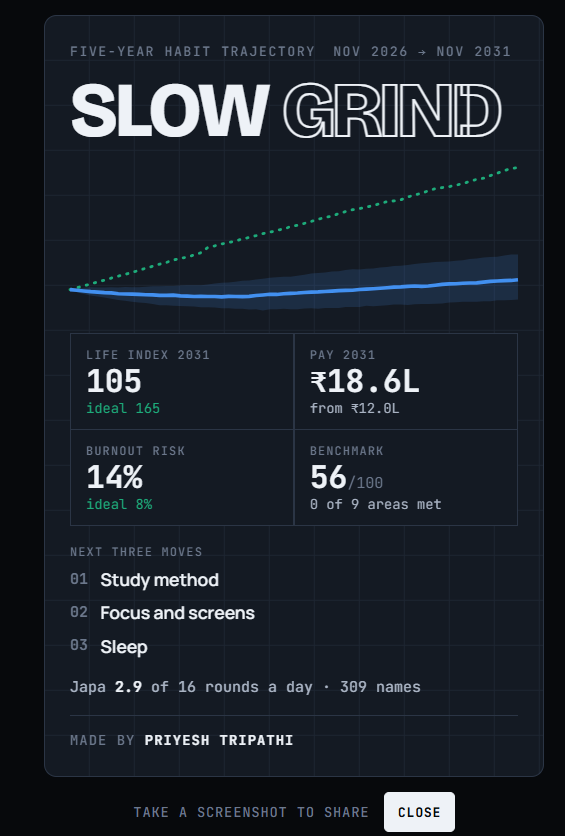
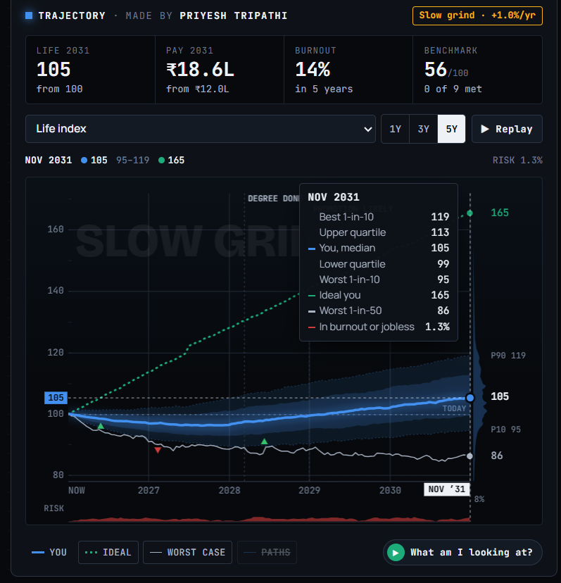
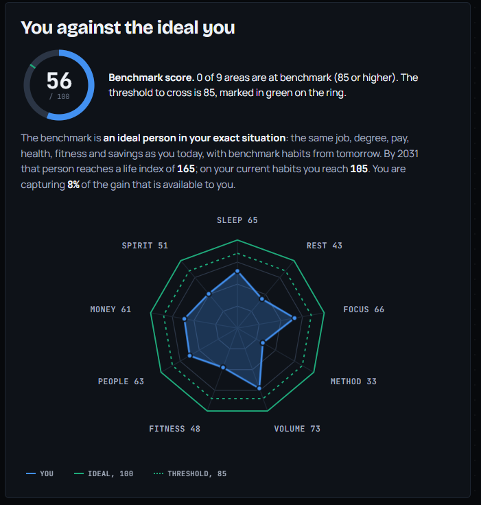

# Habit Trajectory
[Watch the launch video](https://github.com/priyeshtripathi16/-habit-trajectory/releases/download/launch/habit_trajectory_launch_1080p.mp4)

https://github.com/user-attachments/assets/2316bff6-47ad-46cb-b850-6bac0240f0e0

A personal five-year simulator. Enter your everyday habits, such as study hours, reading, sleep, exercise, screen time and savings, and see the range of ways your life could go over the next five years.

The page runs 600 simulated futures, each one a week-by-week path with random shocks such as burnout, job changes and setbacks. The chart shows the median path and the spread around it, so you can see how much your habits matter compared with luck.

## What it does

- Five-year fan chart with a target line, event markers, yearly change labels and replay.
- Life index that blends career, skill, health, relationships, spiritual life and other areas, with weights you can change.
- Benchmark ideal you that you define yourself, with the gap to it shown as a waterfall.
- Single-change ranking, showing which one habit change would move your outcome most.
- Scenarios and a value of an hour ranking for comparing where your time goes.
- 12-month forecast, a daily checklist and a best next move suggestion.
- Setup code that saves your inputs as a short text string you can copy and restore.
- Share card that summarises your result as an image.
- Optional voiceover explaining the chart and the method.

## Run it

No install and no server. Open `index.html` in any modern browser, or use the GitHub Pages link.

## Privacy

Your inputs are stored only in your browser's local storage. Nothing is sent to a server. Clear the site data to remove them.

## How the model works

- Monte Carlo simulation 600 futures in 260 weekly steps, using antithetic pairs and common random numbers so comparisons between scenarios are fair.
- Regime switching job-market regimes, a burnout hazard that rises with strain, layoffs with unemployment spells, and a savings runway.
- Calibration 2,400 prior particles are reweighted against your answers to four self-report questions, so the model's starting point fits you.
- Two-store memory fresh and long-term knowledge, consolidated with a half-life of about 20 weeks.
- The full analysis runs in a Web Worker, and a 120-future preview runs on the main thread so the sliders respond instantly.

This is a planning aid built on assumptions, not a prediction. Treat the numbers as a way to compare choices, not as forecasts.

## Files

## Screenshots

  
  

  
  

- `index.html` the whole app in one file (styles, model, interface and embedded audio).

## Licence

Choose a licence before publishing. See `LICENSE` if included.

---

Made by Priyesh Tripathi
